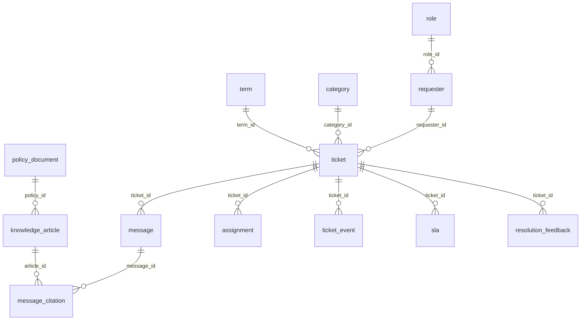

# ER diagram

## Relationships

| Parent | Child | Foreign key | Cardinality | Participation |
|---|---|---|---|---|
| role | requester | role_id | 1:N | mandatory |
| policy_document | knowledge_article | policy_id | 1:N | mandatory |
| term | ticket | term_id | 1:N | mandatory |
| category | ticket | category_id | 1:N | mandatory |
| requester | ticket | requester_id | 1:N | mandatory |
| ticket | message | ticket_id | 1:N | mandatory |
| knowledge_article | message_citation | article_id | N:M bridge | mandatory |
| message | message_citation | message_id | N:M bridge | mandatory |
| ticket | assignment | ticket_id | 1:N | mandatory |
| ticket | ticket_event | ticket_id | 1:N | mandatory |
| ticket | sla | ticket_id | 1:0..1 | mandatory |
| ticket | resolution_feedback | ticket_id | 1:0..1 | mandatory |
